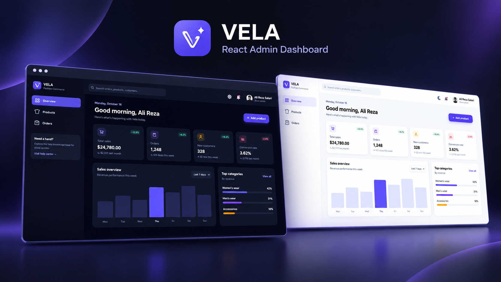

# React Admin Dashboard

A modern admin dashboard built with **React**, **Vite**, and **Tailwind CSS**. This project provides an interface for managing products and orders, with reusable components and a structured layout.

## 📸 Screenshot



## ✨ Features

- Dashboard overview page
- Products management page
- Orders management page
- Sidebar navigation and header layout
- Reusable UI components
- Reusable table components
- Theme management using React Context
- Client-side routing
- Not Found page for unmatched routes
- Sample data for products and orders

## 🛠️ Tech Stack

- **React 19** — UI development
- **Vite** — Development server and build tool
- **Tailwind CSS 4** — Styling
- **React Router** — Client-side navigation
- **React Icons** — Icons
- **UUID** — Unique identifiers
- **ESLint** — Code linting
- **React Compiler** — React optimization

## 🚀 Getting Started

### Prerequisites

Make sure you have the following installed:

- [Node.js](https://nodejs.org/)
- npm

### Installation

1. Clone the repository:

   ```bash
   git clone https://github.com/ali-reza-salari/React-Admin-Dashboard-panel.git
   ```

2. Navigate to the project directory:

   ```bash
   cd React-Admin-Dashboard-panel
   ```
   
3. Install dependencies:

   ```bash
   npm install
   ```

4. Start the development server:

   ```bash
   npm run dev
   ```

5. Open the local URL provided by Vite in your browser.

## 📜 Available Scripts

| Command | Description |
| --- | --- |
| `npm run dev` | Starts the development server |
| `npm run build` | Builds the project for production |
| `npm run preview` | Previews the production build |
| `npm run lint` | Runs ESLint |

## 🧭 Routes

| Route | Page |
| --- | --- |
| `/` | Overview |
| `/products` | Products |
| `/orders` | Orders |
| Any unmatched route | Not Found |

## 📁 Project Structure

```text
src/
├── components/
│   ├── common/
│   │   ├── Header
│   │   ├── Sidebar
│   │   ├── Table
│   │   └── Table components
│   └── layout/
│       └── AdminLayout.jsx
├── contexts/
│   └── Theme.jsx
├── data/
│   └── Sample data and configuration
├── features/
│   ├── Modal
│   ├── OrdersTable
│   ├── PagesTitleSection
│   └── ProductsTable
├── hooks/
│   └── useTitle.jsx
├── pages/
│   ├── Analytics/
│   ├── Customers/
│   ├── NotFound/
│   ├── Orders/
│   ├── Overview/
│   └── Products/
├── App.jsx
├── main.jsx
├── routes.jsx
└── index.css

public/
└── assets/
    └── images/

screenshot/
└── start.png
```

## 📌 Current Project Status

The dashboard currently uses sample/local data for products and orders. Backend and API integration can be added in future updates.

## 👨‍💻 About Me

**Ali Reza Salari**  
Web Developer focused on building modern web applications with React and JavaScript.

### Connect With Me

- **GitHub:** [ali-reza-salari](https://github.com/ali-reza-salari)
- **LinkedIn:** [Ali Reza Salari](https://www.linkedin.com/in/ali-reza-salari/)
- **Instagram:** [alireza_salari.dev](https://www.instagram.com/alireza_salari.dev?stkn=c3I1Zm04bjlwZ28y)
- **My Website:** [Jupixed](https://jupixed.ir/)

---

⭐ If you find this project interesting, feel free to explore the repository!